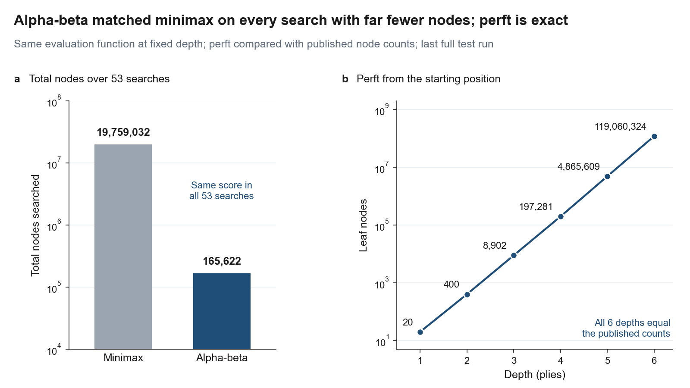

# Bitboard Chess Engine in C++17

The engine is written in C++17 on bitboards. It generates strictly legal moves, searches to a fixed depth with alpha-beta (negamax), and scores positions by material and piece-square tables. Perft (the leaf node count of the legal move tree) from the start position at depth 6 gives 119,060,324 nodes, the published count, and [python-chess](https://github.com/niklasf/python-chess) agrees on 301 positions. Over 53 test searches alpha-beta returned exactly the score of unpruned minimax while visiting 165,622 nodes instead of 19,759,032. Both checks run from one command (see [Testing](#testing)).



## Features

- **Board**: one 64-bit bitboard per piece type and color, plus a mailbox for
  piece lookup. FEN parsing and output.
- **Attacks**: precomputed tables for pawns, knights and kings; sliding pieces
  use the "classical approach" (one ray per direction, cut at the first blocker).
- **Legal move generation** (`src/movegen.cpp`), without playing each move to test for check:
  - single check (capture or block) and double check (king moves only);
  - absolute pins, computed from enemy sliders aligned with the king;
  - king moves tested with the king removed from the occupancy, so the king
    cannot step backwards along a checking line;
  - castling (rights, empty squares, no passing through or into check);
  - en passant, including the case where removing both pawns from one rank
    exposes the king;
  - promotions to knight, bishop, rook or queen.
- **Make / unmake** with an undo stack (captured piece, castling rights,
  en passant square, halfmove clock).
- **Perft** and per-move "divide".
- **Evaluation**: material plus piece-square tables (middle-game tables).
- **Search**: negamax alpha-beta at a fixed depth with MVV-LVA (most valuable victim, least valuable attacker) capture ordering.
  Checkmate and stalemate are detected at every node, including leaves.
  A separate minimax (`minimax_search`, max/min form, White-relative scores,
  no pruning, no ordering) serves as the reference.

## Layout

```
include/   types.h  bitboard.h  position.h  movegen.h  perft.h  eval.h  search.h
src/       bitboard.cpp  position.cpp  movegen.cpp  perft.cpp  eval.cpp  search.cpp  main.cpp
tests/     test_main.cpp                 FEN round trip, perft table, alpha-beta vs minimax
tools/     run_tests.py                  build + all tests, writes results/
           crosscheck_python_chess.py    perft cross-check against python-chess
results/   output of the last full test run (committed so the numbers below can be checked)
```

## Building

Requires CMake 3.16+, Ninja (or another generator) and a C++17 compiler.

```
cmake -S . -B build -G Ninja -DCMAKE_BUILD_TYPE=Release
cmake --build build
```

On Windows, run these from a "x64 Native Tools Command Prompt for VS 2022",
or use `run_tests.bat`, which sets up the MSVC environment itself.

Tested with MSVC 19.43 (Visual Studio 2022) on Windows 11. The code is
standard C++17 and the CMake file has GCC/Clang flags.

## Usage

```
build/chess perft  <depth> [fen]     leaf node count
build/chess divide <depth> [fen]     node count per root move
build/chess search <depth> [fen]     alpha-beta search: score, best move, nodes
build/chess perft-batch <file>       each line "<depth> <fen>"; prints one count per line
```

The FEN defaults to the start position. Example (from `results/05_cli_examples.txt`):

```
$ build/chess.exe search 4 6k1/5ppp/8/8/8/8/5PPP/3R2K1 w - - 0 1
score 99999
bestmove d1d8
nodes 4996
```

Scores are centipawns from the side to move's point of view; a mate in n plies
scores `100000 - n`.

## Testing

One-time setup of the Python environment for the cross-check:

```
python -m venv .venv
.venv\Scripts\python -m pip install -r requirements-dev.txt
```

Then, on Windows:

```
run_tests.bat
```

This configures and builds from scratch, runs `chess_tests`, runs the
python-chess cross-check, and writes each command with its full output to
`results/`. The exit code is non-zero if any check fails.
`python tools/run_tests.py` does the same, given CMake, Ninja and a compiler on
PATH.

The last run (2026-11-10, MSVC 19.43, python-chess 1.11.2, Python 3.10.11)
passed every check: 100 of 100 in `chess_tests` and 301 of 301 in the
cross-check.

### Perft vs published node counts

From `results/03_engine_tests.txt`. Every row also checks that make/unmake
restored the original position (its FEN is unchanged afterwards).

| position | FEN | depth | nodes | result |
|---|---|---:|---:|---|
| startpos | `rnbqkbnr/pppppppp/8/8/8/8/PPPPPPPP/RNBQKBNR w KQkq - 0 1` | 6 | 119,060,324 | pass |
| Kiwipete | `r3k2r/p1ppqpb1/bn2pnp1/3PN3/1p2P3/2N2Q1p/PPPBBPPP/R3K2R w KQkq - 0 1` | 5 | 193,690,690 | pass |
| position 3 | `8/2p5/3p4/KP5r/1R3p1k/8/4P1P1/8 w - - 0 1` | 7 | 178,633,661 | pass |
| position 4 | `r3k2r/Pppp1ppp/1b3nbN/nP6/BBP1P3/q4N2/Pp1P2PP/R2Q1RK1 w kq - 0 1` | 6 | 706,045,033 | pass |
| position 4 (mirrored) | `r2q1rk1/pP1p2pp/Q4n2/bbp1p3/Np6/1B3NBn/pPPP1PPP/R3K2R b KQ - 0 1` | 6 | 706,045,033 | pass |
| position 5 | `rnbq1k1r/pp1Pbppp/2p5/8/2B5/8/PPP1NnPP/RNBQK2R w KQ - 1 8` | 5 | 89,941,194 | pass |
| position 6 | `r4rk1/1pp1qppp/p1np1n2/2b1p1B1/2B1P1b1/P1NP1N2/1PP1QPPP/R4RK1 w - - 0 10` | 5 | 164,075,551 | pass |

The table shows the deepest level; every shallower depth (40 rows in total) was
also compared and passed. Expected values are those on the Chess Programming
Wiki "Perft Results" page, transcribed into `tests/test_main.cpp`.

### Perft vs python-chess

From `results/04_python_chess_crosscheck.txt`. python-chess computes its own
perft (no shared code), and the engine's counts come from `chess perft-batch`.

| set | positions | depth | result |
|---|---:|---:|---|
| standard positions above | 7 | 4 or 5 | 7 / 7 equal |
| random-game positions (seed 2026) | 294 | 3 | 294 / 294 equal |

Of the 294 random root positions, 8 are in check, 11 have a castling move,
5 a promotion and 2 an en passant capture available.

### Alpha-beta vs minimax

From `results/03_engine_tests.txt`: 12 positions (the 7 above, plus a
back-rank mate, queen vs king, an en passant position, a promotion race and a
Black-to-move opening), each at every depth from 1 to 4 or 5, 53 searches in
total. The alpha-beta score equals the minimax score in all 53. A few rows:

| position | depth | minimax score | alpha-beta score | minimax nodes | alpha-beta nodes |
|---|---:|---:|---:|---:|---:|
| startpos | 5 | 70 | 70 | 5,072,213 | 31,547 |
| Kiwipete | 4 | 50 | 50 | 4,185,553 | 7,084 |
| position 4 | 4 | -615 | -615 | 432,071 | 3,795 |
| position 6 | 4 | -110 | -110 | 3,986,610 | 8,667 |
| back_rank_mate_in_1 | 5 | 99999 | 99999 | 486,111 | 36,038 |

Over all 53 searches minimax visited 19,759,032 nodes and alpha-beta 165,622.

## References

Written from scratch. Public material used:

- Chess Programming Wiki: *Perft Results* (test positions and node counts),
  *Classical Approach* (sliding attacks), *Bitboards*, *BitScan* (De Bruijn
  bit scan), *Population Count*, *Encoding Moves* (16-bit move layout),
  *Checks and Pinned Pieces*, *Alpha-Beta*, *MVV-LVA*.
- Tomasz Michniewski, *Simplified Evaluation Function* (Chess Programming
  Wiki): piece values and piece-square tables used in `src/eval.cpp`.
- python-chess (GPL-3.0) is used as an external test oracle installed
  into a local virtual environment.

## License

MIT, see [LICENSE](LICENSE).
